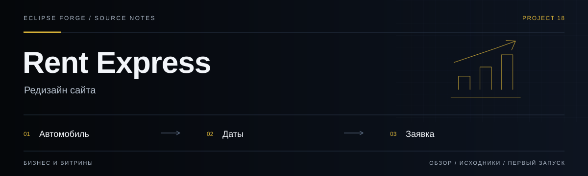
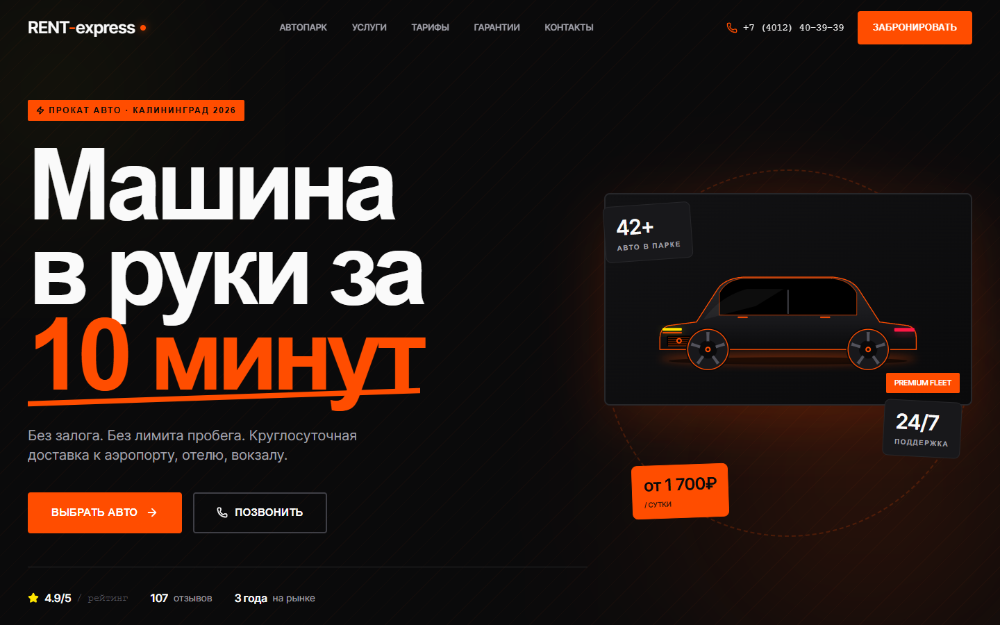
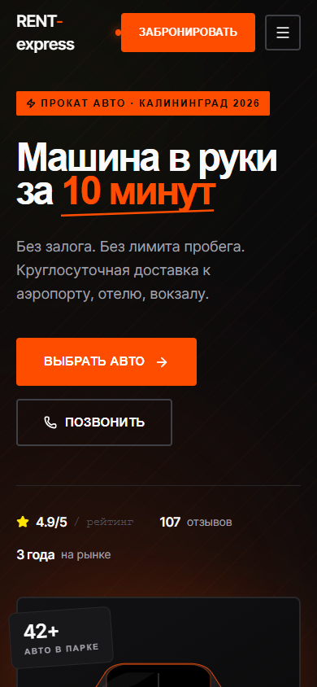

# Rent Express



**Редизайн сайта.** Сайт аренды автомобилей: автопарк, параметры бронирования, этапы аренды и контакты.

<!-- repository-guide:start -->
[Интерфейс](#readme-interface) · [Первый запуск](#readme-start) · [Что внутри](#readme-map) · [Путеводитель](docs/repository-guide.md#start) · [Карта кода](docs/repository-guide.md#map) · [Проверки](docs/repository-guide.md#checks) · [Границы и права](docs/repository-guide.md#boundaries)

<a id="readme-interface"></a>

## Интерфейс



**Главная RENT-express: предложение аренды и переход к выбору автомобиля.**

Локальный снимок от 8 сентября 2026: отдельный профиль браузера, без внешних API и пользовательских секретов. Это вид интерфейса, не подтверждение production-функций.

<details>
<summary><strong>Мобильный экран · 390 px</strong></summary>



</details>

[Открыть в полном размере](docs/assets/ui/overview.png) · [Данные снимка](docs/assets/ui/capture.json)

<a id="readme-map"></a>

## Проект за минуту

- **[Композиция сайта](<src/App.tsx>)** — Порядок секций и общий пользовательский маршрут.
- **[Витрина и заявка](<src/components>)** — Автопарк, блок бронирования и контактные секции.
- **[Контент](<src/data.ts>)** — Данные для отображения на сайте.

<a id="readme-start"></a>

## Начать локально

**Среда:** Node.js и npm. **Источник:** [package.json](<package.json>).

Из корня клонированного репозитория:

```bash
npm ci
npm run dev
```

Запуск сервера разработки не выполняет публикацию. Проверьте настройки окружения и основной пользовательский сценарий перед выпуском.

<details>
<summary><strong>Перед первым запуском и изменением кода</strong></summary>

- Команды сверены с исходниками 8 сентября 2026. Это инструкция, а не отметка об успешном запуске или текущем production.
- Установка зависимостей может обращаться в registry и выполнять lifecycle scripts. Используйте отдельную рабочую среду и демонстрационные данные.
- Форма бронирования в интерфейсе не означает серверное подтверждение заказа; интеграция и коммерческие сведения требуют отдельной проверки.


</details>
<!-- repository-guide:end -->

## Что внутри

React + TypeScript + Vite. Экран состоит из Header, Hero, BookingWidget, Fleet, Advantages, Process, Testimonials, FAQ, Contact, CTA и Footer; композиция задаётся в [src/App.tsx](src/App.tsx).

## Локальный запуск

Установите зависимости согласно package-lock.json (`npm ci`), затем выполните `npm run dev`. Проверки: `npm run typecheck`, `npm run lint`, `npm run build`. Команды здесь перечислены по package.json, а не объявлены успешно выполненными.

## Границы проекта

Это frontend-репозиторий. Доступность автомобилей, цены, отзывы и реальное подтверждение бронирования требуют отдельной проверки перед публичным использованием.
